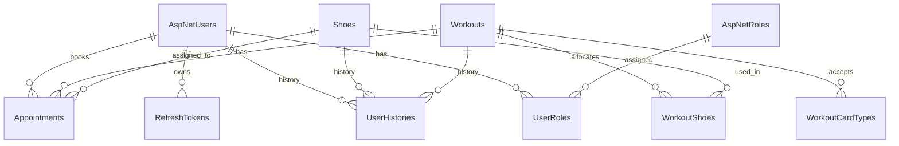

# База данни (PostgreSQL) и API референция

## 1. Схема на базата данни в PostgreSQL (`JumpWithJennyDbContext`)

`JumpWithJennyDbContext` наследява `IdentityDbContext<User, UserRole, string>` и използва `Npgsql.EntityFrameworkCore.PostgreSQL`.

### Общи правила и базови класове
- **`BaseModel`** (`IAuditInfo`): `Id` (`string` GUID по подразбиране), `CreatedOn` (`DateTime`), `ModifiedOn` (`DateTime?`).
- **`BaseDeletableModel`** (`BaseModel`, `IDeletableEntity`): добавя `IsDeleted` (`bool`) и `DeletedOn` (`DateTime?`).
- **Автоматичен одит**: `SaveChanges` / `SaveChangesAsync` попълват `CreatedOn` при `Added` и `ModifiedOn` при `Modified` с `DateTime.UtcNow`.
- **Глобален Soft-Delete филтър**: Всички `IDeletableEntity` типове (`User`, `UserRole`, `Workout`, `Shoes`, `WorkoutShoes`, `WorkoutCardType`, `Appointment`) имат глобален query filter `e => !e.IsDeleted`.
- **Timestamps**: `AppContext.SetSwitch("Npgsql.EnableLegacyTimestampBehavior", true)` → колоните са `timestamp without time zone`.

### Enums (записват се като `integer`)
- **`ShoesSize`**: `s = 1`, `m = 2`, `l = 3`, `xl = 4`
- **`CardType`**: `CoolFit = 1`, `PulseCard = 2`, `IndividualWorkout = 3`

### Таблици и колони

| Таблица (PostgreSQL) | C# Ентитет | Ключови колони и типове | Връзки (FK) и особености |
| :--- | :--- | :--- | :--- |
| **`AspNetUsers`** | `User` (`IdentityUser<string>`, `IAuditInfo`, `IDeletableEntity`) | PK `Id` (`text` GUID), `UserName`, `Email`, `EmailConfirmed`, `PasswordHash`, `FirstName` (`varchar(50)`), `LastName` (`varchar(50)`), `Age` (`int?`), `City` (`varchar(100)`), `ProfilePictureUrl` (`text`), `Description` (`text`), `ProviderId` (`varchar(100)`), `ProviderName` (`varchar(50)`), `IsExternalLogin` (`bool`), `CreatedOn`, `ModifiedOn`, `IsDeleted`, `DeletedOn` | 1:N с `Appointments`, `RefreshTokens`, `UserHistories` |
| **`AspNetRoles`** | `UserRole` (`IdentityRole`, `IAuditInfo`, `IDeletableEntity`) | PK `Id` (`text`), `Name`, `NormalizedName`, audit + soft-delete колони | M:N с `User` чрез `UserRoles` |
| **`UserRoles`** | `IdentityUserRole<string>` | Композитен PK `(UserId, RoleId)` | Преименувана от `AspNetUserRoles`; Cascade към `AspNetUsers` и `AspNetRoles` |
| `AspNetUserClaims`, `AspNetRoleClaims`, `AspNetUserLogins`, `AspNetUserTokens` | Стандартни Identity класове | Стандартни Identity колони | Cascade към `AspNetUsers` / `AspNetRoles` |
| **`Workouts`** | `Workout` (`BaseDeletableModel`) | PK `Id` (`text`), `Day` (`text`, required), `Time` (`text`, required), `Date` (`timestamp`, required), `Status` (`text`, required: `"Available"`, `"Booked"` и др.), `AvailableSpots` (`int`, required), audit + soft-delete | 1:N с `WorkoutShoes`, `Appointments`, `WorkoutCardTypes`, `UserHistories` |
| **`Shoes`** | `Shoes` (`BaseDeletableModel`) | PK `Id` (`text`), `Size` (`integer` — `ShoesSize`, required), audit + soft-delete | 1:N с `WorkoutShoes`, `Appointments`, `UserHistories` |
| **`WorkoutShoes`** | `WorkoutShoes` (`BaseDeletableModel`) | Композитен PK `(WorkoutId, ShoeId)`, `Id` (`text` GUID), `IsTaken` (`bool`), audit + soft-delete | FK `WorkoutId` → `Workouts` (Cascade); FK `ShoeId` → `Shoes` (Cascade) |
| **`Appointments`** | `Appointment` (`BaseDeletableModel`) | Композитен PK `(UserId, WorkoutId)`, `Id` (`text`), `CardType` (`integer?` — `CardType`), `ShoeId` (`text`, nullable), `IsConfirmed` (`bool`), `UsesOwnShoes` (`bool`), audit + soft-delete | FK `UserId` → `AspNetUsers` (Cascade); FK `WorkoutId` → `Workouts` (Cascade); FK `ShoeId` → `Shoes` (nullable) |
| **`WorkoutCardTypes`** | `WorkoutCardType` (`BaseDeletableModel`) | PK `Id` (`text`), `CardType` (`integer` — `CardType`), shadow FK `WorkoutId` (`text`, nullable), audit + soft-delete | Nullable FK `WorkoutId` → `Workouts` |
| **`UserHistories`** | `UserHistory` | PK `Id` (`text`), `UserId` (`text`, required), `ShoeId` (`text`, required), `WorkoutId` (`text`, required), `UsedAt` (`timestamp`) | FK към `AspNetUsers`, `Shoes`, `Workouts` (Cascade). *Бележка: понастоящем не се записва от сървисите.* |
| **`RefreshTokens`** | `RefreshToken` | PK `Id` (`serial int`), `Token` (`text`), `Expires` (`timestamp`), `Created` (`timestamp`), `Revoked` (`timestamp?`), `Locked` (`bool`), `UserId` (`text`) | FK `UserId` → `AspNetUsers` (Cascade след миграция `20250805153429`) |
| **`Images`** | `ImageModel` | PK `Id` (`serial int`), `Name` (`text`), `Url` (`text`), `CreatedAt` (`timestamp`) | Без външни ключове |

### ER Диаграма на релациите

### История на EF Core миграциите (`ServerAPI/ServerAPI/Migrations/`)
1. `20250319214629_InitialCreate` — начална схема (Identity, `Workouts`, `Shoes`, `WorkoutShoes`, `Appointments`, `WorkoutCardTypes`, `UserHistories`, `Images`).
2. `20250408114953_IdfixWorkoutCardType` — корекция на ключ/тип на `WorkoutCardType`.
3. `20250509093730_WorkoutAddDeletible` — добавяне на soft-delete колони към `Workouts`.
4. `20250509144723_AddTokenTable` — добавяне на таблица `RefreshTokens`.
5. `20250513145936_AddLockedBoolRefreshToken` — добавяне на колона `Locked` в `RefreshTokens`.
6. `20250624151255_AddDateToWorkout` — добавяне на колона `Date` в `Workouts`.
7. `20250802154056_AddIsExternalLoginToUser` — добавяне на `IsExternalLogin` в `AspNetUsers`.
8. `20250805153429_AddCascadeDeleteOnRefreshTokens` — каскадно изтриване за `RefreshTokens.UserId`.

### Начално попълване на данни (`JumpWithJennyDbSeeder`)
Изпълнява се при всяко стартиране на API-то (след автоматично `Migrate()` в `Development`):
1. `RolesSeeder` + `AccountSeeder`: създават роли `Administrator` и `User` и seed-ват начален администратор (`GlobalConstants.AccountsSeeding`).
2. `ShoesSeeder`: добавя 14 чифта обувки (7× `S`, 5× `M`, 1× `L`, 1× `XL`), ако `Shoes` е празна.
3. `WorkoutCardTypesSeeder`: добавя 3-те вида карти от `CardType`, ако `WorkoutCardTypes` е празна.
4. `WorkoutSeeder`: добавя 5 начални тренировки и ги свързва с всички обувки в `WorkoutShoes`, ако `Workouts` е празна.
5. `ImageSeeder`: копира изображения от `SeedData/Images/` в `wwwroot/Images/` и ги записва в `Images`, ако `Images` е празна.

---

## 2. Списък на API ендпойнтите в `ServerAPI`

> **Забележка за сигурността:** Колоната **„Достъп (реален в кода)“** отразява точно настоящите атрибути върху контролерите и методите. Част от админ/потребителските маршрути нямат активен `[Authorize]` или имат `[AllowAnonymous]`.

### Root (`Program.cs`)
| Метод | Маршрут | Достъп (реален) | Вход | Изход |
| :--- | :--- | :--- | :--- | :--- |
| `GET` | `/` | Anonymous | — | `200` `{ message: "JumpWithJenny API is running ✅" }` |

### `AccountController` (`/Account`, CORS `"AllowOrigin"`)
| Метод | Маршрут | Достъп (реален) | Входен DTO / параметри | Изходен DTO / отговор |
| :--- | :--- | :--- | :--- | :--- |
| `POST` | `/Account/signup` | Anonymous | `SignUpModel` (`UserName`, `FirstName`, `LastName`, `Password`, `Email`, `Language`) | `200` `{ token, user: UserDto, refreshToken }` / `400` `{ errors }` |
| `POST` | `/Account/login` | Anonymous | `LoginModel` (`Email`, `Password`) | `200` `{ token, user: UserDto, refreshToken }` / `401` `{ errors }` / `404` |
| `POST` | `/Account/confirmemail` | Anonymous | `ConfirmEmailRequest` (`UserId`, `Token`, `Language`) | `200` `{ message, user: UserDto }` / `400` `{ errors }` |
| `GET` | `/Account/verifyEmailStatus` | Anonymous | Query: `userId` (`string`) | `200` `{ user: UserDto }` / `400` `{ errors }` |
| `POST` | `/Account/forgot-password` | Anonymous | `ForgotPasswordRequest` (`Email`, `Language`) | `200` OK / `500` `{ errors }` |
| `POST` | `/Account/reset-password` | Anonymous *(без `[Authorize]`)* | `ResetPasswordRequest` (`Id`, `CurrentPassword`, `NewPassword`) | `200` OK / `400` `{ errors }` |
| `POST` | `/Account/reset-password-token` | Anonymous | `ForgotPasswordResetRequest` (`Email`, `Token`, `NewPassword`) | `200` `{ message }` / `400` `{ errors }` |
| `POST` | `/Account/refresh-token` | Anonymous | `RefreshTokenRequest` (`RefreshToken`) | `200` `{ accessToken, refreshToken, user: UserDto }` / `400` / `401` `AuthResult` |
| `POST` | `/Account/resend-verification` | Anonymous | `ResendEmailRequest` (`Email`, `Language`) | `200` `{ message }` / `400` `{ errors }` |

### `AuthController` (`/api/Auth`)
| Метод | Маршрут | Достъп (реален) | Входен DTO / параметри | Изходен DTO / отговор |
| :--- | :--- | :--- | :--- | :--- |
| `POST` | `/api/Auth/google-login` | Anonymous | `GoogleAuthCodeRequest` (`Code`) | `200` `AuthResult` (`Success`, `Token`, `RefreshToken`, `User`, `Errors`) / `400` / `500` |
| `POST` | `/api/Auth/facebook-login` | Anonymous | `FacebookAuthCodeRequest` (`AccessToken`) | `200` `AuthResult` / `400` / `500` |

### `ScheduleController` (`/api/Schedule`)
| Метод | Маршрут | Достъп (реален) | Входен DTO / параметри | Изходен DTO / отговор |
| :--- | :--- | :--- | :--- | :--- |
| `GET` | `/api/Schedule` | Anonymous | — | `200` `List<WorkoutViewModels>` (филтрирани по `Date >= DateTime.UtcNow.Date`) |
| `GET` | `/api/Schedule/{id}` | Anonymous | Route: `id` | `200` `{ message, workout: { Id, Day, Time, Status, AvailableSpots, Shoes: [{ Id, Size, IsTaken }] } }` / `404` |
| `POST` | `/api/Schedule/apply` | `[Authorize(JwtBearer)]` | `ApplyForWorkoutRequest` (`WorkoutId`, `ShoeSize`, `CardType`, `UserId`, `UsesOwnShoes`; `userId` реално се взима от JWT `NameIdentifier`) | `200` `{ message, workout: { Id, Day, Time, Status, AvailableSpots, Shoes: [{ Id, Size }] } }` / `400` |
| `GET` | `/api/Schedule/is-registered/{workoutId}` | `[Authorize(JwtBearer)]` | Route: `workoutId` (user от JWT) | `200` `bool` / `400` |
| `DELETE` | `/api/Schedule/cancel-registration/{workoutId}` | `[Authorize(JwtBearer)]` | Route: `workoutId` (user от JWT) | `200` `"Registration canceled successfully."` / `404` / `400` |

### `WorkoutController` (`/api/Workout`)
| Метод | Маршрут | Достъп (реален) | Входен DTO / параметри | Изходен DTO / отговор |
| :--- | :--- | :--- | :--- | :--- |
| `POST` | `/api/Workout` | `[AllowAnonymous]` | `WorkoutCreateModel` (`Id`, `Day`, `Time`, `Status`, `AvailableSpots`, `Date`) | `201` `WorkoutCreateModel` |
| `PUT` | `/api/Workout/{id}` | Anonymous *(без атрибут; `[Authorize]` на класа е коментиран)* | Route: `id`, Body: `WorkoutUpdateModel` (`Id`, `Day`, `Time`, `AvailableSpots`) | `200` `WorkoutUpdateModel` / `404` *(Забележка: не извиква `SaveChangesAsync`)* |
| `DELETE` | `/api/Workout/delete-workout/{id}` | `[AllowAnonymous]` | Route: `id` | `204` NoContent / `400` / `404` |
| `GET` | `/api/Workout/{id}` | `[AllowAnonymous]` | Route: `id` | `200` `WorkoutViewModels` / `404` |
| `GET` | `/api/Workout` | `[AllowAnonymous]` | — | `200` `IEnumerable<AdminWorkoutViewModel>` |

### `AdminController` (`/api/Admin`, class-level `[Authorize(Roles = "Administrator")]`)
| Метод | Маршрут | Достъп (реален) | Входен DTO / параметри | Изходен DTO / отговор |
| :--- | :--- | :--- | :--- | :--- |
| `POST` | `/api/Admin/users/create` | `[Authorize(Roles = "Administrator", JwtBearer)]` | `UserCreateViewModel` (`Username`, `Password`, `Email`, `FirstName`, `LastName`, `Role`) | `200` `{ Message }` / `400` |
| `GET` | `/api/Admin/users` | `[Authorize(Roles = "Administrator")]` *(default scheme)* | — | `200` `AllUsersViewModels` (`Users: List<UserViewModel>`) |
| `DELETE` | `/api/Admin/users/{id}` | `[Authorize(Roles = "Administrator")]` *(default scheme)* | Route: `id` | `200` `{ Message }` / `400` |
| `GET` | `/api/Admin/workouts/{id}` | `[AllowAnonymous]` *(override!)* | Route: `id` | `200` `AdminWorkoutViewModel` (`Date >= today`) / `404` |
| `POST` | `/api/Admin/add/participant` | `[AllowAnonymous]` *(override!)* | Query `id` (неизползван), Body: `ApplyForWorkoutRequest` | `200` `Workout` (с `WorkoutShoes` и `Appointments`) / `400` / `404` |
| `DELETE` | `/api/Admin/remove/participant` | `[AllowAnonymous]` *(override!)* | Query: `workoutId`, `userId` | `200` `{ Message }` / `400` / `404` |
| `GET` | `/api/users/search` *(абсолютен маршрут)* | `[AllowAnonymous]` *(override!)* | Query: `query` | `200` `IEnumerable<UserSearchResultModel>` (до 10 резултата) |
| `GET` | `/api/workouts/all` *(абсолютен маршрут)* | `[AllowAnonymous]` *(override!)* | — | `200` `IEnumerable<AdminWorkoutViewModel>` |

### `ShoesController` (`/api/Shoes`)
| Метод | Маршрут | Достъп (реален) | Входен DTO / параметри | Изходен DTO / отговор |
| :--- | :--- | :--- | :--- | :--- |
| `GET` | `/api/Shoes` | Anonymous *(без `[Authorize]`)* | — | `200` `List<ShoesDTO>` (`Id`, `Size`) |
| `GET` | `/api/Shoes/{id}` | Anonymous | Route: `id` | `200` `ShoesDetailsDTO` (`Id`, `Size`, `Workouts`, `Users`) / `404` |
| `POST` | `/api/Shoes` | Anonymous | `ShoesDTO` (`Id`, `Size`) | `201` `Shoes` |
| `PUT` | `/api/Shoes/{id}` | Anonymous | Route: `id`, Body: `ShoesDTO` | `204` NoContent / `400` / `404` |
| `DELETE` | `/api/Shoes/{id}` | Anonymous | Route: `id` | `204` NoContent / `404` |

### `UserController` (`/User`, CORS `"AllowOrigin"`)
| Метод | Маршрут | Достъп (реален) | Входен DTO / параметри | Изходен DTO / отговор |
| :--- | :--- | :--- | :--- | :--- |
| `GET` | `/User/all` | Anonymous *(без `[Authorize]`)* | — | `200` `AllUsersViewModels` (`Users: List<UserViewModel>`) |
| `GET` | `/User/{id}` | Anonymous | Route: `id` | `200` `UserAdminViewModel` (`Id`, `Username`, `Email`, `FirstName`, `LastName`, `Role`) / `404` |
| `PUT` | `/User/change-password` | Anonymous | `ChangePasswordViewModel` (`Id`, `CurrentPassword`, `NewPassword`) | `200` string / `400` |
| `POST` | `/User` | Anonymous | `string` body | Празна stub имплементация (`200` void) |
| `DELETE` | `/User/{id}` | Anonymous | Route: `id` | `200` string / `404` |

### `GalleryController` (`/Gallery`, CORS `"AllowOrigin"`)
| Метод | Маршрут | Достъп (реален) | Входен DTO / параметри | Изходен DTO / отговор |
| :--- | :--- | :--- | :--- | :--- |
| `GET` | `/Gallery` | Anonymous | Query: `page=1`, `pageSize=4` | `200` `IEnumerable<ImageModel>` (`Id`, `Name`, `Url`, `CreatedAt`) |
| `GET` | `/Gallery/all` | `[Authorize(JwtBearer)]` *(без проверка за роля)* | — | `200` `IEnumerable<ImageModel>` |
| `POST` | `/Gallery/upload` | `[Authorize(JwtBearer)]` *(без проверка за роля)* | `multipart/form-data` (`file: IFormFile`) | `200` `ImageModel` / `400` |
| `DELETE` | `/Gallery/{id}` | `[Authorize(JwtBearer)]` *(без проверка за роля)* | Route: `id` | `204` NoContent / `404` |

### `ContactController` (`/api/Contact`) и `WeatherForecastController` (`/WeatherForecast`)
| Метод | Маршрут | Достъп (реален) | Входен DTO / параметри | Изходен DTO / отговор |
| :--- | :--- | :--- | :--- | :--- |
| `POST` | `/api/Contact/send` | Anonymous | `ContactFormDto` (`Name`, `Email`, `Subject`, `Message`) | `200` `{ Message }` / `400` `{ Errors }` |
| `GET` | `/WeatherForecast` | Anonymous | — | `200` `IEnumerable<WeatherForecast>` *(шаблонен остатък)* |

### Основни DTO / ViewModel структури
- **`UserDto`** (`Models/Authentication/UserDTO.cs`): `{ id, email, username, firstname, lastname, emailConfirmed, role }` (lowercase ключове).
- **`AuthResult`**: `{ Success, Token, refreshToken, ExpiresAt, User, Errors }` (смесен регистър: `RefreshToken` има `[JsonPropertyName("refreshToken")]`, но контролерът използва Newtonsoft.Json).
- **`WorkoutViewModels`**: `{ Id, Day, Time, Status, AvailableSpots, Date, WorkoutShoes }`.
- **`AdminWorkoutViewModel`**: `{ Id, Day, Time, Status, CardType, AvailableSpots, Date, WorkoutShoes, Appointments: List<AppointmentViewModel> }`.
- **`AppointmentViewModel`**: `{ Id, UserId, UserFullName, UserEmail, CardType, ShoeId, ShoeSize, UsesOwnShoes }`.
